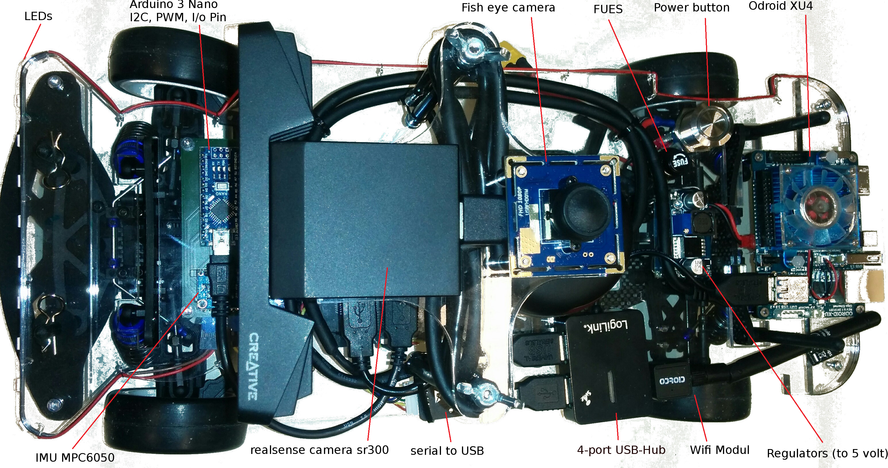
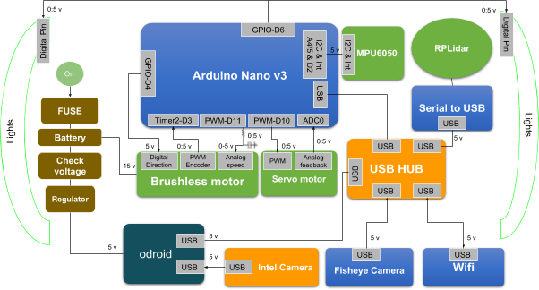

# AutoModelCar La Salle

Repositorio para la documentación, configuración y desarrollo del AutoModelCar V3 modificado.

## Objetivo

Este repositorio documenta:

* Instalación del sistema operativo en Odroid XU4.
* Instalación de ROS Kinetic.
* Configuración de la Intel RealSense SR300.
* Programación del Arduino Nano.
* Modificaciones de hardware.
* Modificaciones de software.
* Registro histórico de avances.

## Estructura

- ├── hardware
- ├── odroid
- ├── arduino
- ├── realsense
- └── modificaciones

## Hardware principal

* Odroid XU4
* Arduino Nano
* Intel RealSense SR300
* ESC
* Servo de dirección
* Chasis AutoModelCar V3

## Estado del proyecto

* \[ ] Configuración inicial
* \[ ] Pruebas de dirección
* \[ ] Pruebas de velocidad
* \[ ] Integración RealSense
* \[ ] Navegación autónoma

## Autor

Miguel Angel García
Universidad La Salle México

