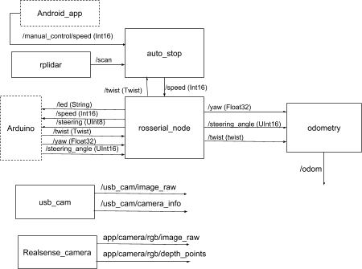

# Instalación de ROS Kinetic


## Agregar repositorios


```bash
sudo sh -c 'echo "deb http://packages.ros.org/ros/ubuntu xenial main" > /etc/apt/sources.list.d/ros-latest.list'
```


## Llaves

```bash
sudo apt install curl # if you haven't already installed curl
```
```bash
curl -s https://raw.githubusercontent.com/ros/rosdistro/master/ros.asc | sudo apt-key add -
```

## Instalación

```bash
sudo apt update
```
```bash
sudo apt install ros-kinetic-desktop-full
```

## Environment setup

```bash
echo "source /opt/ros/kinetic/setup.bash" >> \~/.bashrc
```
```bash
source \~/.bashrc
```


## Dependencies for building packages

```bash
sudo apt install python-rosdep python-rosinstall 
```
```bash
python-rosinstall-generator python-wstool build-essential 
```


## Initialize rosdep


```bash
sudo apt install python-rosdep
```

```bash
sudo rosdep init
```
```bash
rosdep update
```


## Create a ROS Workspace


```bash
source /opt/ros/kinetic/setup.bash
```

```bash
mkdir -p ~/catkin_ws/src
```

```bash
cd ~/catkin_ws/
```


```bash
catkin_make
```

```bash
source /opt/ros/kinetic/setup.bash
```


## Make sure ROS\_PACKAGE\_PATH environment variable includes the directory you're in


```bash
echo "source ~/catkin_ws/devel/setup.bash" >> ~/.bashrc
```
```bash
source ~/.bashrc
```





