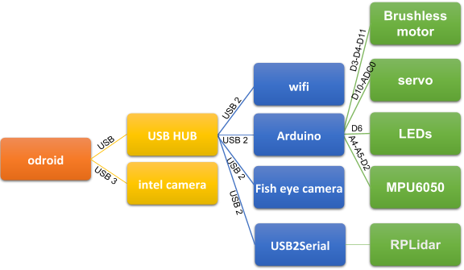

# Installing Ubuntu on the Odroid XU4


## Requirements


- Odroid XU4

- microSD card or eMMC

- USB adapter




## Downloading the image


Download a compatible version of Ubuntu for the [Odroid XU4](https://odroid.in/ubuntu_16.04lts/). Since the official version is not available, download the compatible `ubuntu-16.04.3-4.9-mate-odroid-xu4-20171025.img.xz` version.


## Writing the image

First, extract the image using:


```
unxz ubuntu-16.04.3-4.9-mate-odroid-xu4-20171025.img.xz
```

(if it is not installed, you can install it with `sudo apt-get unxz`)


If you have an eMMC-to-microSD adapter, identify how the system recognizes it. For example: `mmcblk0`, `mmcblk0p1`, `mmcblk0p2`, `mmcblk0p3`.


Linux:


```bash
sudo dd if=ubuntu.img of=/dev/mmcblk0p1 bs=4M status=progress
```


## You can also use Balena Etcher


1\. Select the image.

2\. Select the microSD card (identifier).

3\. Select Flash.

4\. Verify that it was installed correctly.


## Updating


```bash
sudo apt update
sudo apt upgrade -y
```


Remember that for this version, the username and password are: **odroid**
